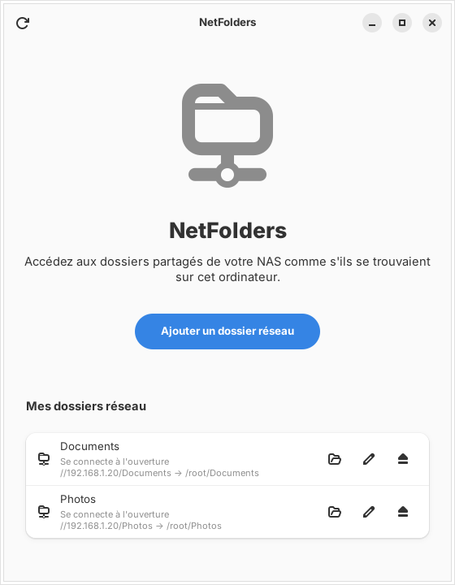
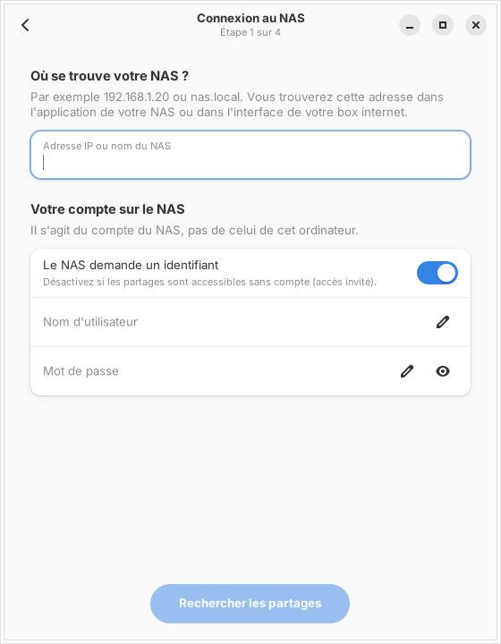
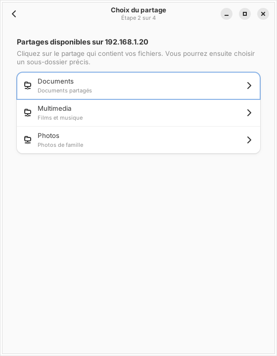
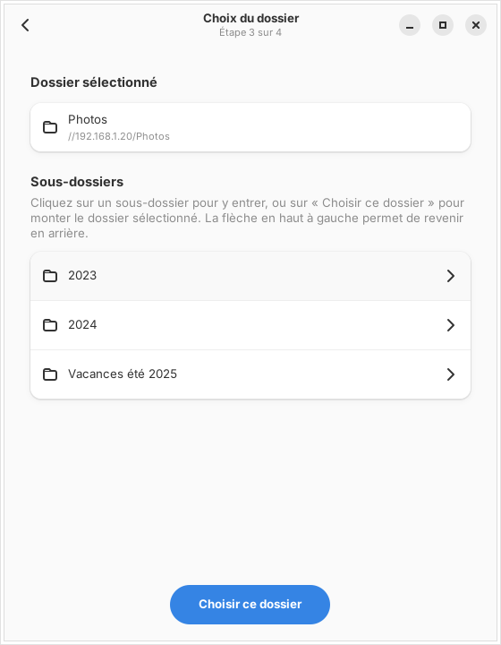
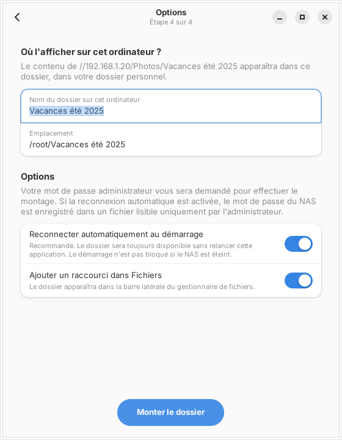
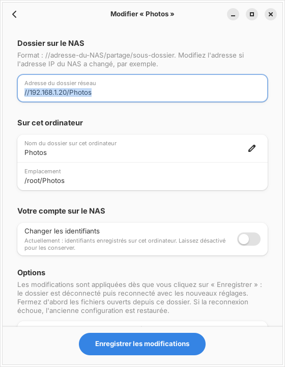
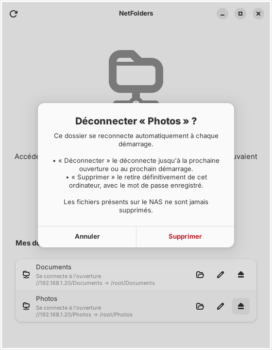

<div align="center">

# NetFolders

**Accédez aux dossiers de votre NAS sous Linux comme s'ils étaient sur votre ordinateur, sans ouvrir de terminal.**

[](https://github.com/loganxwolverine/NetFolders/actions/workflows/build.yml)
[](https://github.com/loganxwolverine/NetFolders/releases/latest)
[](LICENSE)


[English](README.md) · **Français**



</div>

---

Sous Linux, monter durablement un dossier de NAS oblige souvent à installer
`cifs-utils`, créer un point de montage, écrire une ligne dans `/etc/fstab` et
protéger son mot de passe dans un fichier d'identifiants. **NetFolders fait
tout cela pour vous**, à travers une interface simple et guidée.

## Fonctionnalités

- 🧭 **Assistant en 4 étapes** : adresse du NAS → partage → dossier → où l'afficher. Chaque écran explique quoi faire.
- 📂 **Navigation dans les partages** et les sous-dossiers du NAS avant de choisir quoi monter.
- 🔁 **Reconnexion automatique au démarrage**, sans ralentir ni bloquer le démarrage si le NAS est éteint.
- 🗂️ **Gestion de tous vos dossiers réseau**, y compris ceux créés avant NetFolders : ouvrir, modifier (nouvelle adresse IP, nouveau mot de passe, autre nom…), déconnecter ou supprimer.
- ↩️ **Retour en arrière automatique** : si une modification échoue, l'ancienne configuration est restaurée.
- ⭐ **Raccourci dans la barre latérale** de Fichiers (GNOME) ou de Dolphin (KDE).
- 💬 **Messages d'erreur clairs** : mot de passe incorrect, NAS injoignable, ancien protocole SMB1…

## Captures d'écran

| 1. Connexion | 2. Choix du partage | 3. Choix du dossier |
|:---:|:---:|:---:|
|  |  |  |
| **4. Options** | **Modifier un dossier existant** | **Déconnecter ou supprimer** |
|  |  |  |

## Distributions prises en charge

NetFolders nécessite **GTK 4** et **libadwaita 1.5 ou plus récent**.

| Famille | Distributions | Version minimale | Paquet |
|---|---|---|---|
| **Fedora** | Fedora Workstation | 40 | `install.sh` |
| **Fedora Atomic** | Bazzite, Silverblue, Kinoite… | actuelle | `install.sh` |
| **Debian** | Debian, Ubuntu, Linux Mint, Pop!_OS, Zorin… | Debian 13 · Ubuntu 24.04 · Mint 22 | `.deb` ou `install.sh` |
| **Arch** | Arch Linux, CachyOS, EndeavourOS, Manjaro… | rolling | paquet Arch, `PKGBUILD` ou `install.sh` |
| **SteamOS** | SteamOS 3 (Steam Deck, mode bureau) | — | `install.sh` *(expérimental)* |

## Installation

Téléchargez les fichiers depuis la **[dernière version](https://github.com/loganxwolverine/NetFolders/releases/latest)**.

### Debian, Ubuntu, Linux Mint

```bash
sudo apt install ./netfolders_*_amd64.deb
```

`apt` installe automatiquement les dépendances (`smbclient`, `cifs-utils`, `pkexec`).

### Arch Linux, CachyOS

```bash
sudo pacman -U netfolders-*-x86_64.pkg.tar.zst
```

Ou compilez-le vous-même avec [`packaging/arch/PKGBUILD`](packaging/arch/PKGBUILD) et `makepkg -si`.

### Fedora, Bazzite, SteamOS (et toutes les distributions ci-dessus)

```bash
tar xzf netfolders-*-x86_64.tar.gz
cd netfolders
./install.sh
```

Le script détecte votre distribution et s'adapte :

- **Fedora** : installe les paquets manquants avec `dnf`.
- **Bazzite / Fedora Atomic** : utilise `rpm-ostree` (**redémarrage nécessaire** si des paquets ont été ajoutés) et gère le système en lecture seule.
- **Debian / Arch** : utilise `apt` / `pacman`.
- **SteamOS** : déverrouille temporairement le système pour ajouter les paquets. Une mise à jour de SteamOS peut les supprimer ; il suffit alors de relancer `./install.sh`.

NetFolders apparaît ensuite dans le menu des applications.

## Fonctionnement

| Vous choisissez… | NetFolders… |
|---|---|
| **Reconnexion au démarrage : activée** *(par défaut)* | Monte le dossier tout de suite **et** l'ajoute à `/etc/fstab` avec `x-systemd.automount,_netdev,nofail`. Le mot de passe est rangé dans `/etc/samba/credentials/` (lisible par root uniquement). |
| **Reconnexion au démarrage : désactivée** | Monte le dossier tout de suite, sans rien écrire sur le disque. Il disparaît au redémarrage. |

Les changements sont **appliqués immédiatement**, après la saisie du mot de passe administrateur. Pas besoin de redémarrer.

Sous le capot : `smbclient` pour explorer le NAS, `mount.cifs` pour le montage, `/etc/fstab` et systemd pour la persistance. Aucun service ne tourne en arrière-plan.

### Sécurité

- Le mot de passe du NAS **n'apparaît jamais sur une ligne de commande** (`ps`). Il passe par des fichiers en `0600`.
- L'application tourne en utilisateur normal. Les droits administrateur sont demandés **via polkit** (la fenêtre de mot de passe standard du système), uniquement pour le montage lui-même.
- `/etc/fstab` est sauvegardé dans `/etc/fstab.netfolders.bak` avant chaque modification.
- Les fichiers du NAS ne sont **jamais supprimés**. Supprimer un dossier réseau le retire seulement de cet ordinateur.

## Désinstallation

- `.deb` : `sudo apt remove netfolders`
- Paquet Arch : `sudo pacman -R netfolders`
- `install.sh` : `./uninstall.sh`

Les dossiers réseau configurés restent en place. Supprimez-les d'abord depuis l'application si vous n'en voulez plus.

## Compiler depuis les sources

Dépendances de compilation : Rust (stable), fichiers de développement de GTK 4 et libadwaita.

```bash
# Fedora :  sudo dnf install cargo gtk4-devel libadwaita-devel
# Debian :  sudo apt install cargo libgtk-4-dev libadwaita-1-dev
# Arch :    sudo pacman -S rust gtk4 libadwaita
cargo build --release
cargo test
```

Ou `./install.sh --compiler` pour compiler et installer d'un coup. Sur Bazzite, la compilation se fait dans un conteneur `distrobox` jetable.

## Feuille de route

- [ ] Interface en anglais (et autres langues)
- [ ] Publication sur l'AUR
- [ ] Prise en charge de NFS

## Contribuer

Les signalements de bugs et les idées sont les bienvenus dans les [issues](https://github.com/loganxwolverine/NetFolders/issues).
Pour un problème, indiquez votre distribution et le message d'erreur exact.

## Licence

[MIT](LICENSE) © loganxwolverine
