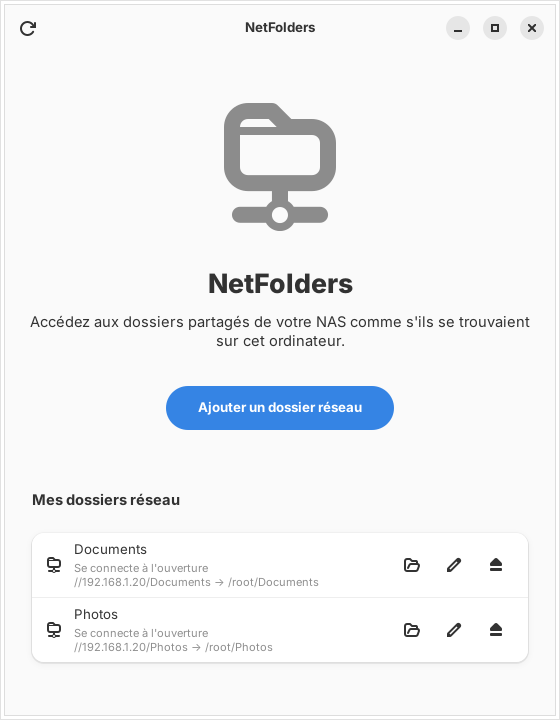
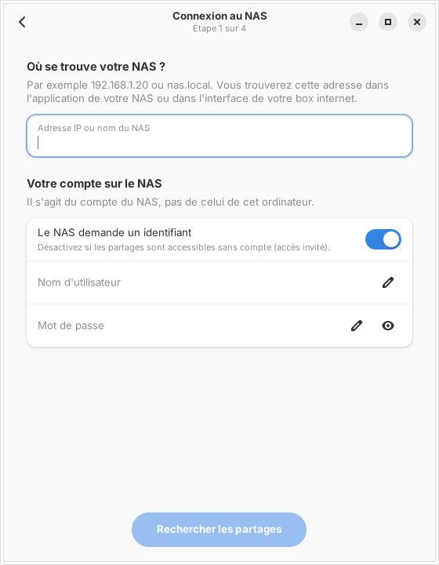
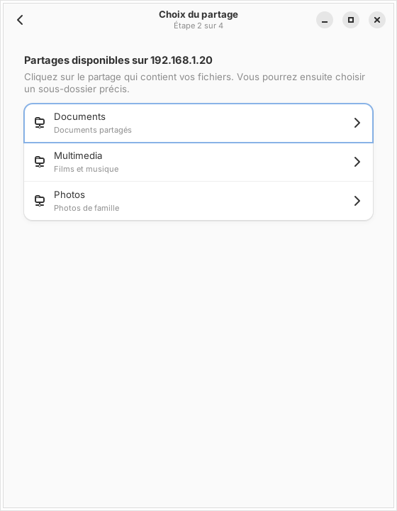
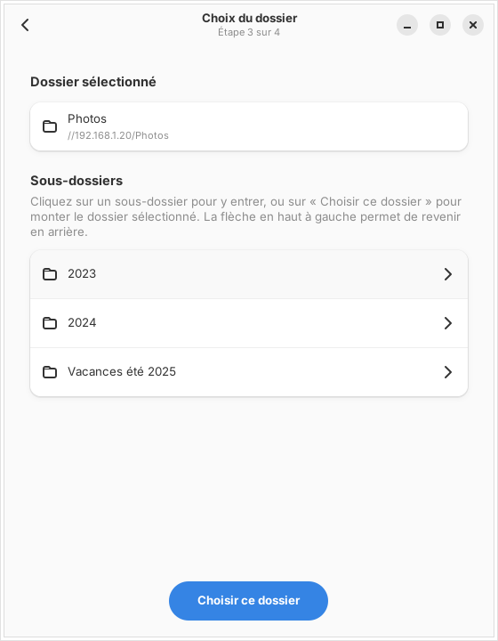
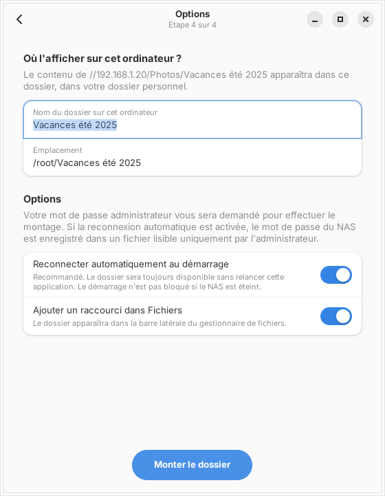
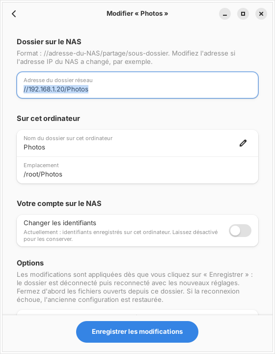
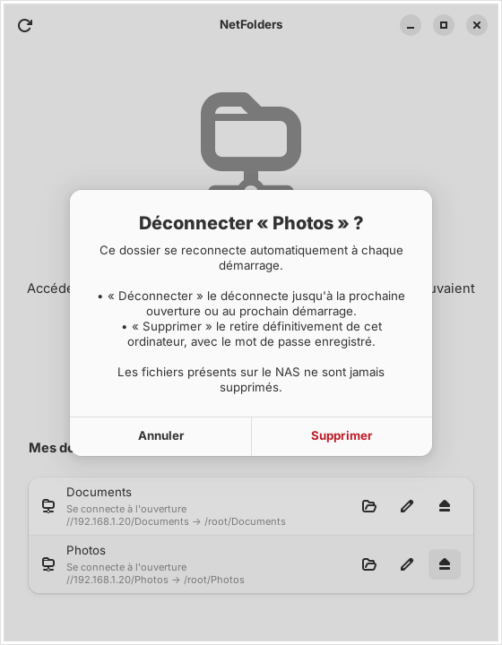

<div align="center">

# NetFolders

**Mount your NAS folders on Linux as if they were local, without touching a terminal.**

[](https://github.com/loganxwolverine/NetFolders/actions/workflows/build.yml)
[](https://github.com/loganxwolverine/NetFolders/releases/latest)
[](LICENSE)


**English** · [Français](README.fr.md)



</div>

---

On Linux, setting up a NAS share that survives a reboot usually means installing
`cifs-utils`, creating a mount point, writing a line in `/etc/fstab` and hiding
your password in a credentials file. **NetFolders does all of that for you**,
through a simple step-by-step interface.

> [!NOTE]
> The interface is currently in **French**. An English translation is planned.

## Features

- 🧭 **4-step wizard**: NAS address → share → folder → where to show it. Every screen explains what to do.
- 📂 **Browse the NAS** shares and subfolders before choosing what to mount.
- 🔁 **Reconnect automatically at boot**, without slowing or blocking the boot if the NAS is off.
- 🗂️ **Manage all your network folders**, including those created before NetFolders: open, edit (new IP address, new password, new name…), disconnect or remove.
- ↩️ **Automatic rollback**: if an edit fails, the previous configuration is restored.
- ⭐ **Sidebar shortcut** in GNOME Files or KDE Dolphin.
- 💬 **Clear error messages**: wrong password, NAS unreachable, outdated SMB1 protocol…

## Screenshots

| 1. Connect | 2. Choose a share | 3. Choose a folder |
|:---:|:---:|:---:|
|  |  |  |
| **4. Options** | **Edit an existing folder** | **Disconnect or remove** |
|  |  |  |

## Supported distributions

NetFolders needs **GTK 4** and **libadwaita 1.5 or newer**.

| Family | Distributions | Minimum version | Package |
|---|---|---|---|
| **Fedora** | Fedora Workstation | 40 | `install.sh` |
| **Fedora Atomic** | Bazzite, Silverblue, Kinoite… | current | `install.sh` |
| **Debian** | Debian, Ubuntu, Linux Mint, Pop!_OS, Zorin… | Debian 13 · Ubuntu 24.04 · Mint 22 | `.deb` or `install.sh` |
| **Arch** | Arch Linux, CachyOS, EndeavourOS, Manjaro… | rolling | Arch package, `PKGBUILD` or `install.sh` |
| **SteamOS** | SteamOS 3 (Steam Deck, desktop mode) | — | `install.sh` *(experimental)* |

## Installation

Download the files from the **[latest release](https://github.com/loganxwolverine/NetFolders/releases/latest)**.

### Debian, Ubuntu, Linux Mint

```bash
sudo apt install ./netfolders_*_amd64.deb
```

`apt` installs the dependencies (`smbclient`, `cifs-utils`, `pkexec`) automatically.

### Arch Linux, CachyOS

```bash
sudo pacman -U netfolders-*-x86_64.pkg.tar.zst
```

Or build it yourself from [`packaging/arch/PKGBUILD`](packaging/arch/PKGBUILD) with `makepkg -si`.

### Fedora, Bazzite, SteamOS (and all the above)

```bash
tar xzf netfolders-*-x86_64.tar.gz
cd netfolders
./install.sh
```

The script detects your distribution and adapts:

- **Fedora**: installs the missing packages with `dnf`.
- **Bazzite / Fedora Atomic**: uses `rpm-ostree` (**a reboot is needed** if packages were added) and handles the read-only system.
- **Debian / Arch**: uses `apt` / `pacman`.
- **SteamOS**: temporarily unlocks the read-only system to add the packages. A SteamOS update may remove them; just run `./install.sh` again.

NetFolders then appears in your application menu.

## How it works

| You choose… | NetFolders does… |
|---|---|
| **Reconnect at boot: on** *(default)* | Mounts the folder now **and** adds it to `/etc/fstab` with `x-systemd.automount,_netdev,nofail`. The password goes to `/etc/samba/credentials/` (readable by root only). |
| **Reconnect at boot: off** | Mounts the folder now only. Nothing is written to disk, and the folder is gone after a reboot. |

Changes are **applied immediately**, right after you enter your administrator password. No reboot needed.

Under the hood: `smbclient` to browse the NAS, `mount.cifs` to mount, `/etc/fstab` and systemd for persistence. No background service.

### Security

- The NAS password **never appears on a command line** (`ps`). It goes through files with `0600` permissions.
- The application runs as your normal user. Administrator rights are requested **through polkit** (the standard system password dialog), only for the actual mount operation.
- `/etc/fstab` is backed up to `/etc/fstab.netfolders.bak` before every change.
- Files on the NAS are **never deleted**. Removing a network folder only removes it from this computer.

## Uninstall

- `.deb`: `sudo apt remove netfolders`
- Arch package: `sudo pacman -R netfolders`
- `install.sh`: `./uninstall.sh`

Network folders you configured stay in place. Remove them from the application first if you no longer want them.

## Building from source

Build dependencies: Rust (stable), GTK 4 and libadwaita development files.

```bash
# Fedora:  sudo dnf install cargo gtk4-devel libadwaita-devel
# Debian:  sudo apt install cargo libgtk-4-dev libadwaita-1-dev
# Arch:    sudo pacman -S rust gtk4 libadwaita
cargo build --release
cargo test
```

Or `./install.sh --compiler` to build and install in one go. On Bazzite, the build runs inside a disposable `distrobox` container.

## Roadmap

- [ ] English interface (and other languages)
- [ ] Publish on the AUR
- [ ] NFS support

## Contributing

Bug reports and ideas are welcome in the [issues](https://github.com/loganxwolverine/NetFolders/issues).
When reporting a problem, please mention your distribution and the exact error message.

## License

[MIT](LICENSE) © loganxwolverine
