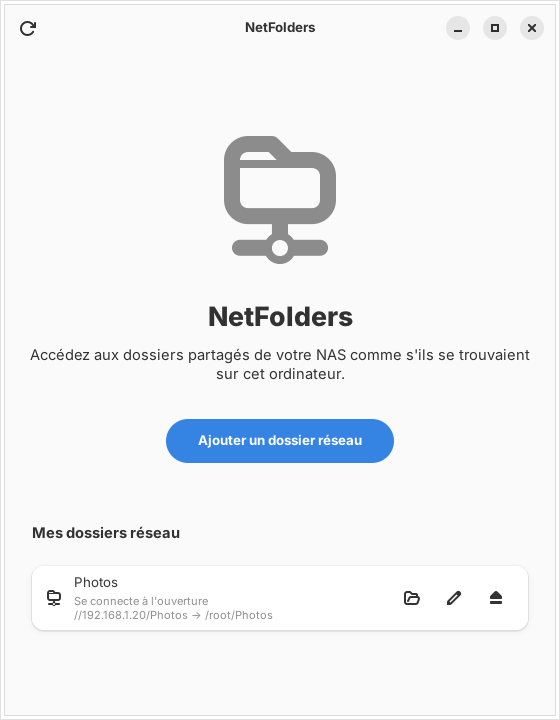
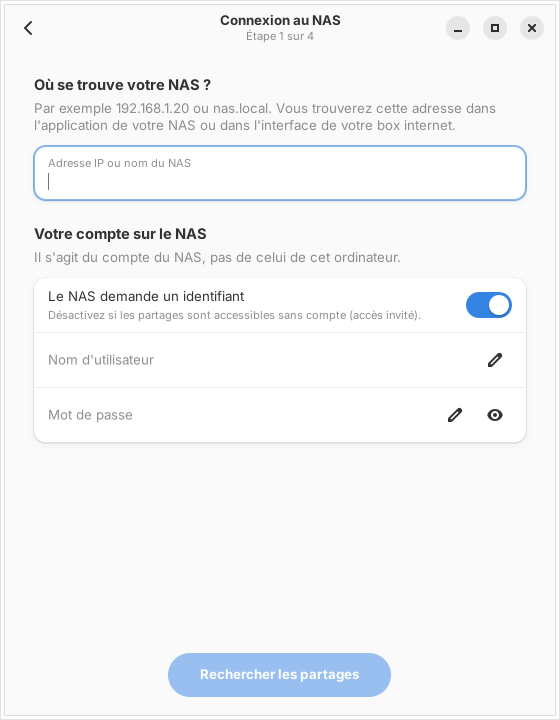
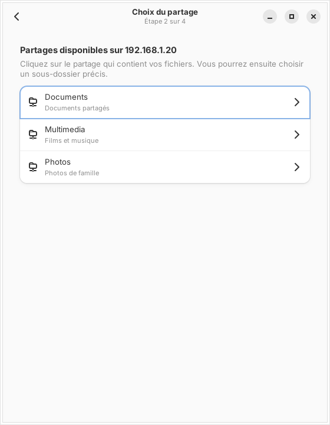
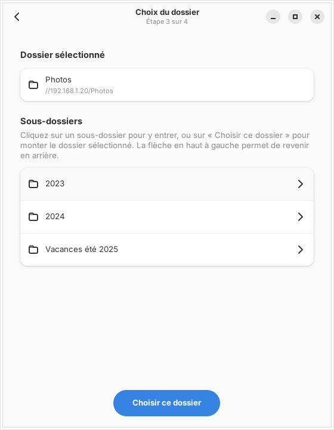
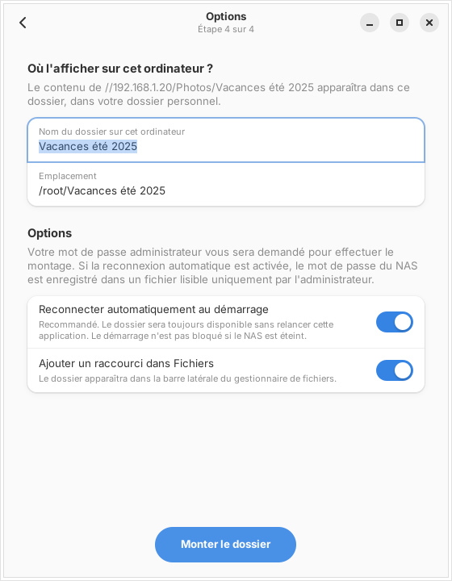
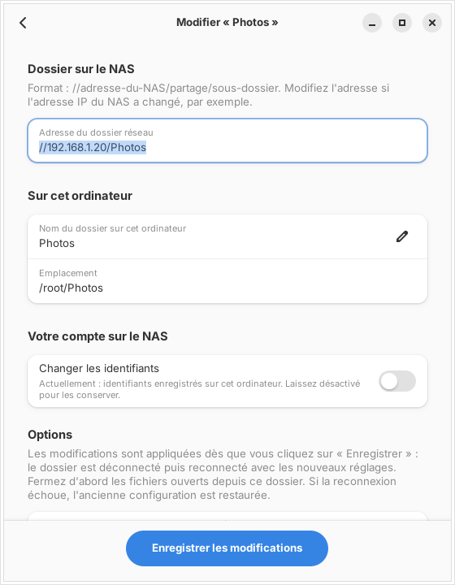

# NetFolders

Application graphique pour Fedora qui permet de monter et de gérer les dossiers
partagés d'un NAS (SMB/CIFS) sans terminal. Un assistant en 4 étapes guide
l'ajout d'un dossier. Écrite en Rust avec GTK4 et libadwaita (l'interface native de GNOME).

| Accueil | 1. Connexion | 2. Partage |
|---|---|---|
|  |  |  |

| 3. Dossier | 4. Options | Modification |
|---|---|---|
|  |  |  |

## Installation

```bash
./install.sh
```

Ce script installe le programme déjà compilé (`bin/netfolders`) et l'ajoute au
menu des applications sous le nom **NetFolders**. Aucun outil de compilation
n'est nécessaire. S'il trouve l'ancienne version (« Dossiers réseau » /
`monter-nas`), il la retire ; les dossiers réseau déjà configurés sont conservés.

Pour recompiler depuis les sources (environ 650 Mo d'outils Rust/GTK) :
`./install.sh --compiler`.

Pour la désinstaller : `./uninstall.sh`. Les dossiers réseau configurés restent
en place ; on les supprime depuis l'application avant.

## Utilisation

### Ajouter un dossier réseau

1. **Connexion** : l'adresse IP du NAS, puis le nom d'utilisateur et le mot de passe
   (ou l'accès invité).
2. **Partage** : choisir le partage qui contient les fichiers.
3. **Dossier** : entrer dans les sous-dossiers si besoin, puis « Choisir ce dossier ».
4. **Options** : le nom du dossier local, la reconnexion au démarrage et le raccourci dans Fichiers.

### Montage temporaire ou permanent ?

| « Reconnecter automatiquement au démarrage » | Effet |
|---|---|
| **Activé** (par défaut) | Le dossier est monté tout de suite **et** ajouté à `/etc/fstab`. Il revient après chaque redémarrage. Avec `nofail` et `x-systemd.automount`, le démarrage n'est pas bloqué si le NAS est éteint : la connexion se fait à la première ouverture du dossier. Le mot de passe est enregistré dans `/etc/samba/credentials/` (lisible par root uniquement). |
| Désactivé | Le dossier est monté tout de suite, mais rien n'est écrit dans `/etc/fstab` et le mot de passe n'est pas enregistré. Il disparaît au prochain redémarrage. |

### Dossiers réseau existants

La page d'accueil liste **tous** les dossiers réseau SMB/CIFS de l'ordinateur,
y compris ceux créés avant l'installation de NetFolders (ancien script, ajout
manuel dans fstab…). Ils sont lus dans `/etc/fstab` et dans les montages actifs.
Pour chacun :

- 📂 **Ouvrir** dans Fichiers ;
- ✏️ **Modifier** : l'adresse sur le NAS (si l'IP a changé, par exemple), le nom
  du dossier local, les identifiants (conservés par défaut), la reconnexion au
  démarrage et le raccourci ;
- ⏏️ **Déconnecter** (jusqu'au prochain démarrage) ou **Supprimer** (retire l'entrée
  fstab, le mot de passe enregistré et le raccourci ; les fichiers du NAS ne sont jamais touchés).

### Quand les changements sont-ils appliqués ?

**Immédiatement**, dès le clic sur « Monter le dossier », « Enregistrer les
modifications » ou « Supprimer », après la saisie du mot de passe administrateur.
Il n'y a pas besoin de redémarrer.

Pour une modification, NetFolders déconnecte le dossier, met à jour `/etc/fstab`
puis le reconnecte avec les nouveaux réglages. **Si la reconnexion échoue,
l'ancienne configuration est restaurée**, y compris fstab et les identifiants.
Une copie de sauvegarde de fstab est aussi gardée dans `/etc/fstab.netfolders.bak`
à chaque modification.

À noter : une modification réécrit l'entrée avec les options standard de
NetFolders. Les options ajoutées à la main dans fstab (par ex. `vers=`) ne sont
pas reprises.

## Fonctionnement technique

- `smbclient` (paquet `samba-client`) sert à lister les partages et les dossiers.
- `mount -t cifs` (paquet `cifs-utils`) sert au montage.
- Les opérations root sont faites par le même exécutable relancé via
  `pkexec netfolders --helper`. La demande est transmise en JSON sur l'entrée
  standard ; le mot de passe n'apparaît jamais dans la liste des processus.
- Les noms avec espaces et accents sont gérés, y compris dans fstab (`\040`).

## Développement

```bash
cargo run      # lancer
cargo test     # tests unitaires
```
